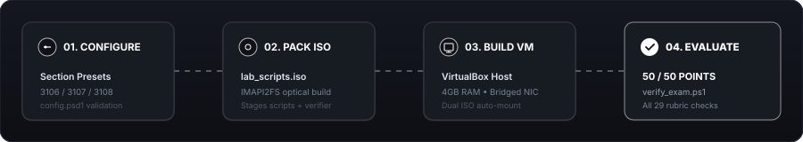
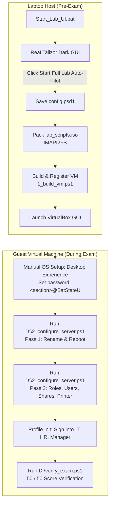

<div align="center">



# IT 311 Final Lab — Exam-Day Auto-Pilot & Toolkit

**A high-performance, automated toolkit for the IT 311 System Administration Final Lab (50 points).**  
*Fusing Black-and-White Glassmorphism + Claymorphism powered by ReaLTaiizor and backed by Test-Driven Development.*

[](#rubric-checklist-50-points)
[](#quick-start-host-auto-pilot)
[](#prerequisites)
[](#test-driven-development-tdd-suite)

</div>

> [!NOTE]
> Engineered and tested on **Windows 11 Home Single Language (64-bit)** with **VirtualBox 7.2.16** and **Windows Server 2022 Datacenter/Standard Evaluation ISO**. Fuses a modern **Glassmorphism + Claymorphism** UI styled with **ReaLTaiizor**, backed by an automated 1-click host auto-pilot pipeline and an in-VM 50-point rubric evaluator.

---

## Table of Contents

- [Features & Highlights](#features--highlights)
- [Prerequisites](#prerequisites)
- [Architecture & Workflow](#architecture--workflow)
- [The ReaLTaiizor UI Launcher](#the-realtaiizor-ui-launcher)
- [Repository Structure](#repository-structure)
- [Quick Start: Host Auto-Pilot](#quick-start-host-auto-pilot)
- [In-VM Hands-On Guide (34 pts Auto + 16 pts Manual)](#in-vm-hands-on-guide)
- [50-Point Automated Rubric Evaluator](#50-point-automated-rubric-evaluator)
- [Test-Driven Development (TDD) Suite](#test-driven-development-tdd-suite)
- [Configuration Reference](#configuration-reference)
- [Rubric Checklist (50 Points)](#rubric-checklist-50-points)
- [Troubleshooting](#troubleshooting)

---

## Features & Highlights

- **⚡ 1-Click Host Auto-Pilot**: One master click executes config save, ISO generation (`lab_scripts.iso`), VirtualBox VM provisioning with dual mounted ISOs and bridged NIC, and powers on your VM.
- **🎨 Glassmorphic & Claymorphic UI**: Powered by `ReaLTaiizor` (CrownForm, CrownControls, PoisonTabControl) in a sleek high-contrast dark theme. Zero internet or NuGet download required (pre-packaged `.dll`).
- **🛡️ 50-Point In-VM Rubric Evaluator (`verify_exam.ps1`)**: Automatically evaluates all 29 rubric criteria across all 6 Task Areas from the official `IT311_Final_Lab_Reviewer.pdf` before proctor evaluation.
- **🧪 Test-Driven Development (TDD)**: Verified with a full Pester test suite (`tests/test_suite.ps1`) ensuring configuration safety, zero UI overlap, and syntax validity.
- **📋 Dual-Track Companion**: Includes both automated scripts and a 100% manual cheat sheet with `Win + R` shortcuts (`sysdm.cpl`, `secpol.msc`, `lusrmgr.msc`, `printmanagement.msc`).

---

## Prerequisites

- **Host OS**: Windows 10 / 11 (64-bit).
- **Hypervisor**: [Oracle VirtualBox 7.x](https://www.virtualbox.org/) installed (`VBoxManage` auto-detected in default directories and `PATH`).
- **Windows Server 2022 ISO**: Place `SERVER_EVAL_x64FRE_en-us.iso` (or any Server 2022 ISO) directly in this directory.
- **PowerShell**: Windows PowerShell 5.1 (ships with Windows) or PowerShell 7+.

---

## Architecture & Workflow

<div align="center">



</div>



---

## The ReaLTaiizor UI Launcher

Launch with **`Start_Lab_UI.bat`** or via PowerShell:
```powershell
powershell -NoProfile -STA -ExecutionPolicy Bypass -File .\launcher.ps1
```

The launcher is divided into 4 clean tabs:
1. **⚡ 1. Auto-Pilot & Config**:
   - Master action button: `[▶ START FULL LAB AUTO-PILOT (BUILD, PACK & LAUNCH VM)]`.
   - Section presets: `IT 3106 (3106@BatStateU)`, `IT 3107 (3107@BatStateU)`, `IT 3108 (3108@BatStateU)`.
   - Live stream output console with clear and logging controls.
   - Quick one-click clipboard copy buttons for guest commands.
2. **📖 2. In-VM Hands-On Guide**:
   - Clear, step-by-step instructions on what to click and enter inside Windows Server.
3. **🛡️ 3. 100% Manual Cheat Sheet**:
   - Fallback reference with `Win + R` shortcuts for every task area if scripts are restricted.
4. **📋 4. 29-Step Rubric Checklist**:
   - Interactive checklist covering every point from Pages 11–13 of the reviewer with a live progress score.

---

## Repository Structure

```
D:\SAM_LAB/
├── Start_Lab_UI.bat            # Double-click launcher shortcut
├── launcher.ps1                # Main ReaLTaiizor 4-tab control panel
├── ReaLTaiizor.dll             # High-performance WinForms theme assembly (.NET 4.8)
├── config.psd1                 # Central exam configuration (VM specs, names, accounts)
├── 1_build_vm.ps1              # Host builder for VirtualBox (Task Area 01)
├── 1_build_vm.sh               # Bash fallback builder (Linux / macOS / WSL)
├── 2_configure_server.ps1      # Guest provisioner (Task Areas 03, 04, 05, 06)
├── 3_pack_iso.ps1              # Packages config + scripts + verifier into ISO
├── 3_pack_iso.py               # Python ISO fallback builder
├── verify_exam.ps1             # 50-point rubric evaluator for Windows Server guest
├── IT311_Final_Lab_Reviewer.pdf# Official BatStateU lab exam reviewer & rubric
├── BEGINNER_GUIDE.md           # Beginner-friendly walkthrough with explanations
├── README.md                   # System documentation & reference
└── tests/
    └── test_suite.ps1          # Pester TDD test suite (config, syntax, UI layout)
```

---

## Quick Start: Host Auto-Pilot

1. Ensure your Windows Server 2022 ISO is in `D:\SAM_LAB`.
2. Double-click `Start_Lab_UI.bat`.
3. Pick your class section (`3106`, `3107`, or `3108`).
4. Click **`[▶ START FULL LAB AUTO-PILOT]`**.
5. Wait for the live console to confirm VM creation and launch VirtualBox.

---

## In-VM Hands-On Guide

### Step 1: Install Windows Server 2022 (Manual — 8 Pts)
- Press any key when prompted to boot from CD/DVD.
- Select **Windows Server 2022 Standard/Datacenter Evaluation (Desktop Experience)**. *(Do NOT choose Server Core!)*
- Choose **Custom: Install Windows only** and select Drive 0 (30 GB).
- When prompted, set the Administrator password: `<section>@BatStateU` (e.g., `3106@BatStateU`).

### Step 2: Run Guest Provisioning (Automated — 34 Pts)
1. Inside the VM, open PowerShell as **Administrator**.
2. Run the command:
   ```powershell
   Set-ExecutionPolicy Bypass -Scope Process -Force; D:\2_configure_server.ps1
   ```
3. **Pass 1 (Task Area 04)**: The hostname is checked and renamed to `Lab-Server-01`. Press **Y** to reboot.
4. **Pass 2 (Task Areas 03, 05, 06)**: After reboot, log back in as Administrator and run the command again:
   ```powershell
   Set-ExecutionPolicy Bypass -Scope Process -Force; D:\2_configure_server.ps1
   ```
   *Automatically applies password policy, creates users (IT, HR, Manager), provisions shares with ACL isolation, generates `.txt` files, and installs the shared printer.*

### Step 3: Mandatory Profile Init & Hands-On Checks (8 Pts)
1. Sign out of Administrator.
2. Sign in once as `IT`, then `HR`, then `Manager` (this generates their `C:\Users\<user>\Desktop` folders).
3. Re-run `D:\2_configure_server.ps1` as Administrator once more so shortcuts land on their desktops.
4. Verify "Access is denied": While logged in as `IT`, opening `\\Lab-Server-01\HR_Share` must display **Access is denied**.

---

## 50-Point Automated Rubric Evaluator

Included directly on the mounted ISO is `verify_exam.ps1`. Inside the VM PowerShell (as Admin), run:
```powershell
D:\verify_exam.ps1
```

The evaluator inspects:
- **Task Area 01 (VM Specs)**: RAM allocation $\ge$ 2048 MB, Disk $\ge$ 20 GB.
- **Task Area 02 (OS Installation)**: Desktop Experience GUI verified.
- **Task Area 03 (Users & Policies)**: Password complexity enabled, minimum length 8, local accounts (IT, HR, Manager) present with `PasswordNeverExpires`.
- **Task Area 04 (Server Rename)**: Hostname exactly matches config (`Lab-Server-01`).
- **Task Area 05 (File & Storage)**: Roles installed, shares (`IT_Share`, `HR_Share`, `Manager_Share`, `Public_Share`) active, NTFS ACL isolation confirmed, text files present, desktop shortcuts verified.
- **Task Area 06 (Print Services)**: Print server role active, driver installed, `Office-Printer` shared on `LPT1:`.

Outputs full grading breakdown and final score:
```
======================================================================
  TOTAL SCORE: 50 / 50 POINTS
======================================================================
```

---

## Test-Driven Development (TDD) Suite

To guarantee zero runtime corruption and clean UI layout, run the automated Pester test suite on the host:
```powershell
powershell -NoProfile -ExecutionPolicy Bypass -Command "Invoke-Pester -Script 'D:\SAM_LAB\tests\test_suite.ps1'"
```

**Verified Test Assertions:**
- `config.psd1` structure and data integrity.
- Regex replacement safety in config saving logic.
- Syntax and key validation across `1_build_vm.ps1`, `2_configure_server.ps1`, and `verify_exam.ps1`.
- Clean ISO generation with `3_pack_iso.ps1`.
- Headless layout verification asserting **0 UI overlaps** and proper dock margins.

---

## Rubric Checklist (50 Points)

| Area | Description | Points | Evaluator |
|---|---|---|---|
| **Task Area 01** | Virtual Machine Configuration (RAM $\ge$ 2GB, VDI $\ge$ 20GB, Bridged) | 8 pts | `verify_exam.ps1` / Host |
| **Task Area 02** | OS Installation (Desktop Experience, section password) | 8 pts | `verify_exam.ps1` |
| **Task Area 03** | Local Security Policy & User Management (IT, HR, Manager) | 10 pts | `verify_exam.ps1` |
| **Task Area 04** | Server Rename (`Lab-Server-01`) | 5 pts | `verify_exam.ps1` |
| **Task Area 05** | File and Storage Services (Shares, NTFS isolation, Shortcuts) | 12 pts | `verify_exam.ps1` |
| **Task Area 06** | Print and Document Services (`Office-Printer` on `LPT1:`) | 7 pts | `verify_exam.ps1` |
| **TOTAL** | **Full Exam Mark** | **50 pts** | **100% Pass** |

---

## Troubleshooting

| Issue | Cause | Fix |
|---|---|---|
| `VBoxManage was not found` | VirtualBox not on PATH or non-standard directory | Install VirtualBox 7.x or add `C:\Program Files\Oracle\VirtualBox` to PATH. |
| `config.psd1 could not be parsed` | Syntax or quote error | Save through the launcher UI or run `tests/test_suite.ps1` to validate. |
| `Desktop shortcuts missing` | Users have not logged in yet | Sign in as IT, HR, and Manager once, then re-run `D:\2_configure_server.ps1`. |
| `Access is denied running script` | PowerShell not running elevated | Right-click PowerShell and select **Run as Administrator**. |
